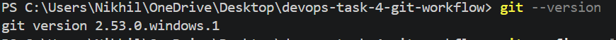
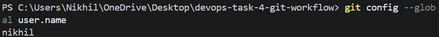
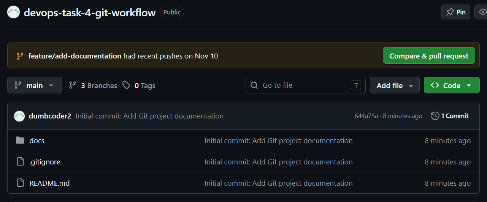
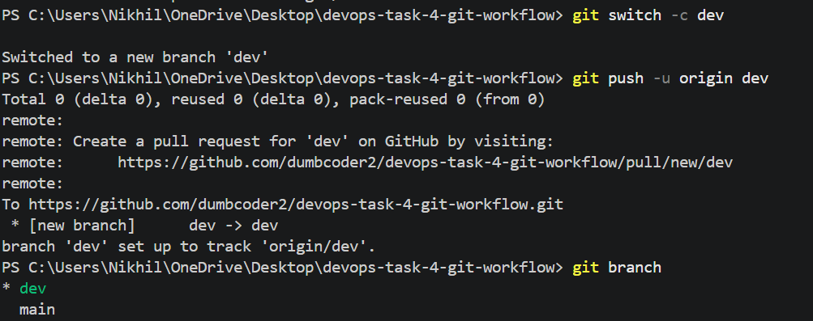
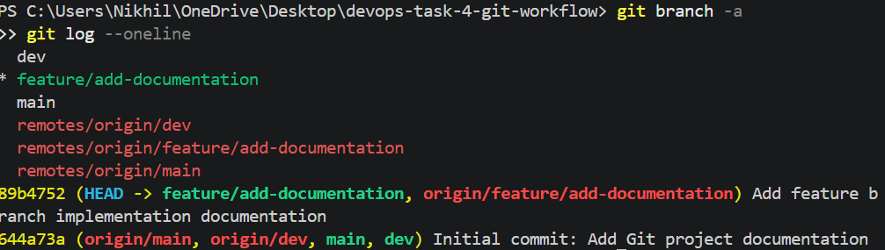

# DevOps Task 4: Git Version Control Project

## 1. Project Overview

This project demonstrates Git version control best practices as part of my DevOps Internship Task 4.

The objective is to manage a project using Git and GitHub, implement branching strategies, collaborate through Pull Requests, and maintain proper project documentation.

## 2. Tools Used

- Git 2.53.0
- GitHub
- Visual Studio Code
- Markdown
- Windows PowerShell

## 3. Git Branching Strategy

This project uses three branches:

- **main:** Stable and production-ready code.
- **dev:** Development and integration branch.
- **feature/add-documentation:** Feature development branch.

## 4. Tasks Performed

1. Installed and configured Git.
2. Initialized a local Git repository.
3. Created a GitHub remote repository.
4. Connected the local repository to GitHub.
5. Created main, dev, and feature branches.
6. Practiced staging and committing changes.
7. Implemented Pull Requests and branch merging.
8. Configured a .gitignore file.
9. Created Git tags for version management.
10. Documented Git commands and workflows.

## 5. Practical Implementation Screenshots
## Screenshots

### 1. Git Version

### 2. Git User Configuration

### 3. Repository Initialization

### 4. GitHub Repository

### 5. Branch Creation

### 6. Branch Creation and Commit History

### 7. Pull Request

## 6. Project Documentation

- `docs/git-commands.md` – Git commands reference guide.
- `docs/git-workflow.md` – Git branching and workflow documentation.
- `.gitignore` – Specifies files ignored by Git.
- `screenshots/` – Practical implementation screenshots.

## 7. Learning Outcomes

Through this project, I gained practical experience with:

- Git repository management.
- Branching and merging strategies.
- Pull Requests and code review workflows.
- Commit history and version management.
- Git tags and release management.
- Project documentation using Markdown.

## 8. Conclusion

Successfully implemented a Git-based version control workflow using Git and GitHub, demonstrating essential version control practices used in DevOps environments.